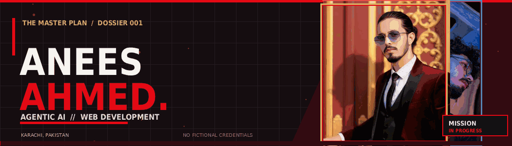
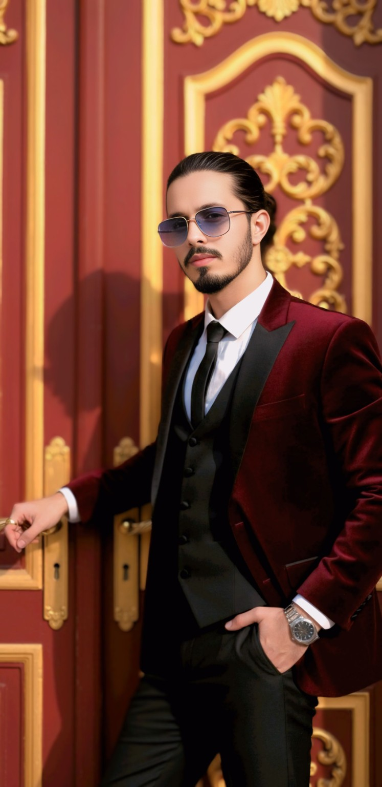
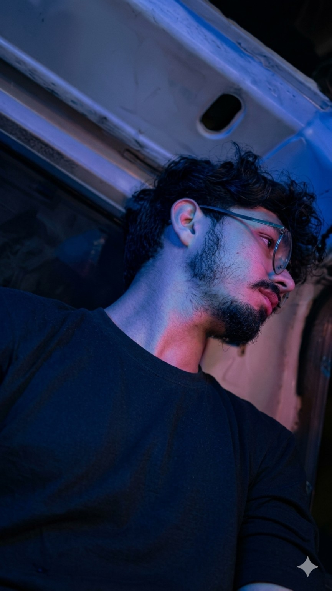

<!--
  ANEES AHMED — THE MASTER PLAN
  GitHub-compatible README. Designed by Anees Ahmed.
  Animated visuals use GIF, because GitHub sanitizes custom JS/CSS in README.md.
  Assets refer to the existing assets/ folder in this repository.
-->

<div align="center">

<a href="https://aneesqurashi.github.io/Money-Heist-Portfolio/" title="Visit the live portfolio">
  
</a>

<br />


<h3>THE MASTER PLAN // A PERSONAL PORTFOLIO</h3>
<p><strong>Agentic AI Student · Aspiring Web Developer · Former Restaurant Training Manager</strong></p>
<p><em>Learning AI. Building Skills. Creating My Future.</em></p>
<p><a href="https://aneesqurashi.github.io/Money-Heist-Portfolio/"><strong>LIVE PORTFOLIO ↗</strong></a> &nbsp;·&nbsp; <a href="https://aneesqurashi.github.io/Money-Heist-Portfolio/README-animated.html"><strong>ANIMATED HTML DOSSIER ↗</strong></a> &nbsp;·&nbsp; <a href="resume/Anees_Ahmed_Public_Resume.pdf"><strong>PUBLIC-SAFE RESUME ↗</strong></a></p>

</div>

---

### 01 // THE IDENTITY

<div align="center">
  <table>
    <tr>
      <td align="center" width="50%">
        
        <br /><sub><b>THE IDENTITY / HERO PORTRAIT</b></sub>
      </td>
      <td align="center" width="50%">
        
        <br /><sub><b>THE PLAN / SECONDARY PORTRAIT</b></sub>
      </td>
    </tr>
  </table>
</div>

I'm **Anees Ahmed**, based in **Karachi, Pakistan**. I'm currently studying **Agentic AI at Saylani Mass IT Training (SMIT)** and learning web development and programming fundamentals.

My professional background is in hospitality. At **Pizza Max**, I progressed from **Bus Boy → Server → Senior Server → Training Manager**, developing experience in staff training, guest service, leadership, restaurant operations and team coordination. I worked there from **2021 to December 2025**.

I'm also a **Hafiz-e-Quran**, and value discipline, consistency and lifelong learning.

### 02 // THE JOURNEY

| Period | Mission | Details |
| :--- | :--- | :--- |
| **2021 – Dec 2025** | **Pizza Max · Karachi** | Progressed through hospitality roles to Training Manager; staff training, restaurant operations, guest service and team leadership |
| **Current** | **Agentic AI · SMIT** | Ongoing studies in AI agents and related technologies |
| **Current** | **Intermediate** | Ongoing |
| **2022** | **Matriculation** | Prince English Secondary School · A-One grade |
| **Completed** | **Hifz-e-Quran** | Hafiz-e-Quran |

### 03 // THE GANG: SKILLS & LEARNING

**Experience-backed:** `Team Leadership` · `Staff Training` · `Customer Service` · `Restaurant Operations` · `POS` · `Team Coordination` · `Guest Complaint Handling`

**Currently learning:** `Agentic AI` · `JavaScript / Node.js (Beginner)` · `Web Development`

**Areas of interest:** `Python` · `Cybersecurity` · `AI Tools`

> This dossier represents my **real learning journey**. It does not claim professional software-engineering employment, invented projects or unverified certifications.

### 04 // THE BLUEPRINT: THIS REPOSITORY

```text
Money-Heist-Portfolio/
├── index.html                       # Live Money Heist-inspired portfolio
├── style.css                        # Responsive red/black/gold design
├── script.js                        # Navigation, themes, interactions
├── README.md                        # GitHub profile of this project
├── README-animated.html             # Fully animated HTML dossier
├── assets/
│   ├── anees-red-suit.jpg           # Original hero portrait
│   ├── anees-blue-portrait.png      # Original secondary portrait
│   ├── readme-heist-banner.gif      # GitHub-compatible animated banner
│   └── readme-cover.jpg             # Static banner fallback
└── resume/
    └── Anees_Ahmed_Public_Resume.pdf
```

The primary website is built with **HTML5, CSS3 and vanilla JavaScript**, with an original red-alert / stealth-mode design, animated sections and mobile-responsive navigation. The standalone animated dossier is a separate optional page.

To view locally, open `index.html` for the portfolio or `README-animated.html` for the companion dossier. Or run `python -m http.server 8000` in the project root and visit `http://localhost:8000/README-animated.html`.

### 05 // THE DROP ZONE

<div align="center">

<a href="https://github.com/AneesQurashi"></a>
<a href="https://www.instagram.com/anee5_ahmed"></a>
<a href="https://www.facebook.com/share/19KHuo5vs2/"></a>
<a href="https://www.tiktok.com/@anee5.ahmed?"></a>
<a href="https://pk.linkedin.com/in/a%C9%B4%E1%B4%87%E1%B4%87%EA%9C%B1-q%E1%B4%9C%CA%80%E1%B4%80%EA%9C%B1%CA%9C%C9%AA-%E3%83%84-748636331"></a>
<a href="https://x.com/anees_ahmmed"></a>

<p><strong><a href="mailto:Ahmmedanees0@gmail.com">Email</a></strong> &nbsp; | &nbsp; <strong><a href="https://wa.me/923323250646">WhatsApp</a></strong></p>
<hr />
<p><sub>ORIGINAL PERSONAL PORTFOLIO · MONEY HEIST–INSPIRED CINEMATIC DIRECTION · KARACHI, PAKISTAN</sub></p>
<p><strong>Designed by Anees Ahmed.</strong></p>

</div>
